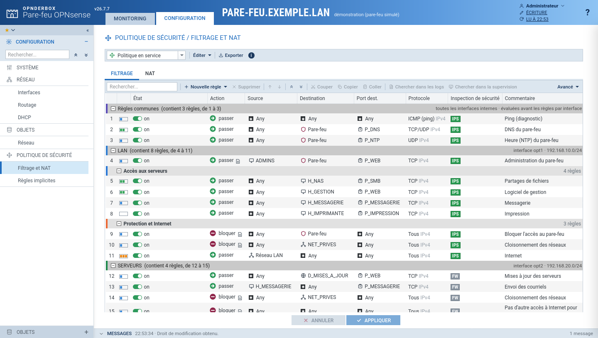
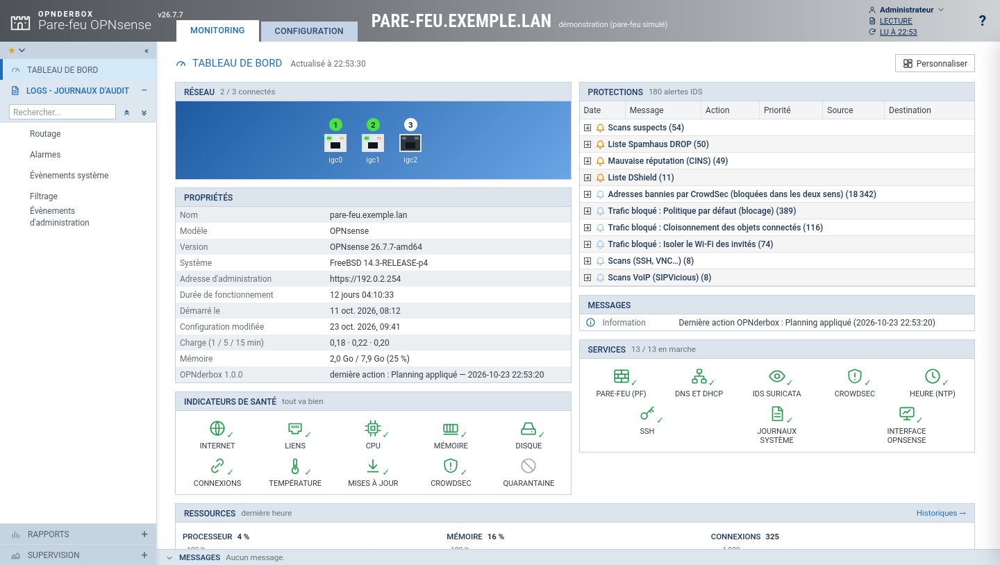
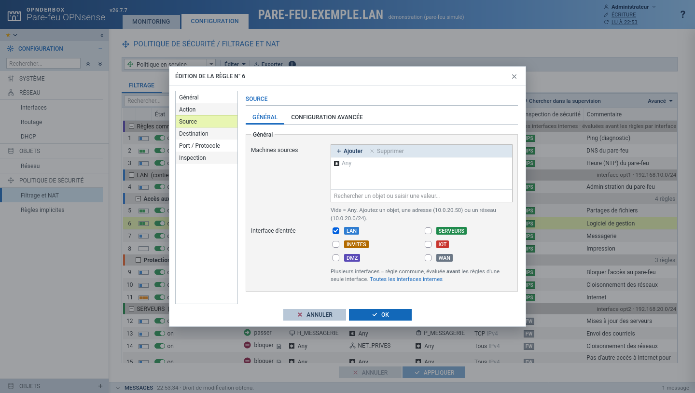
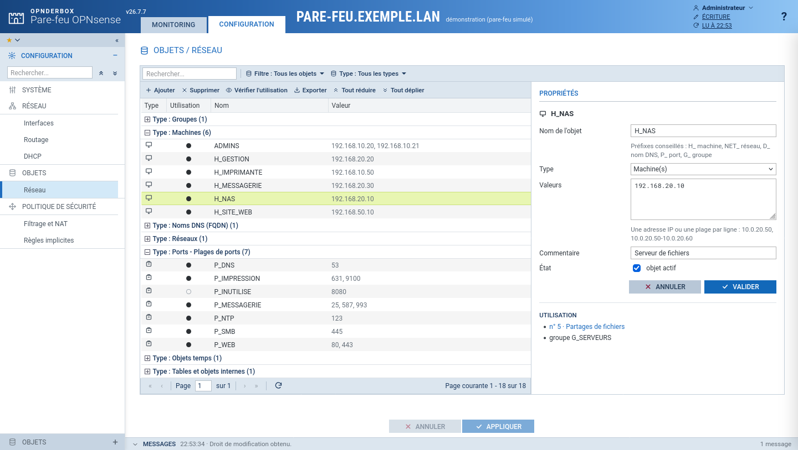
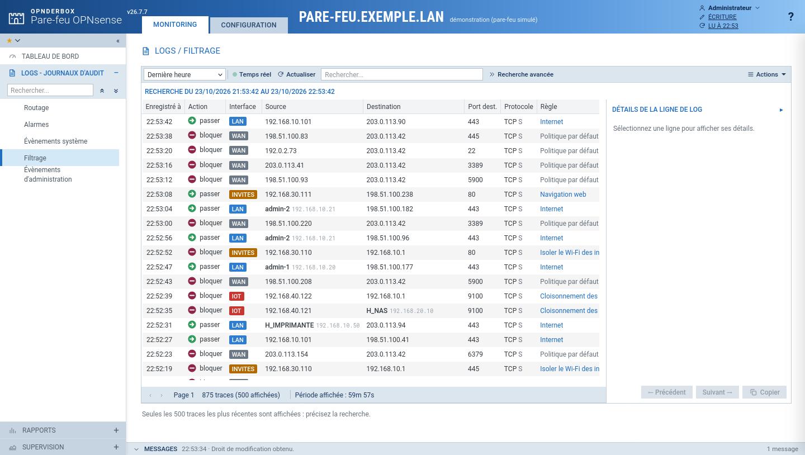
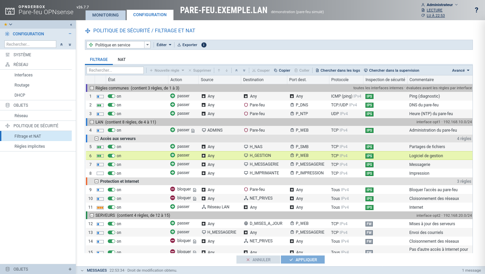
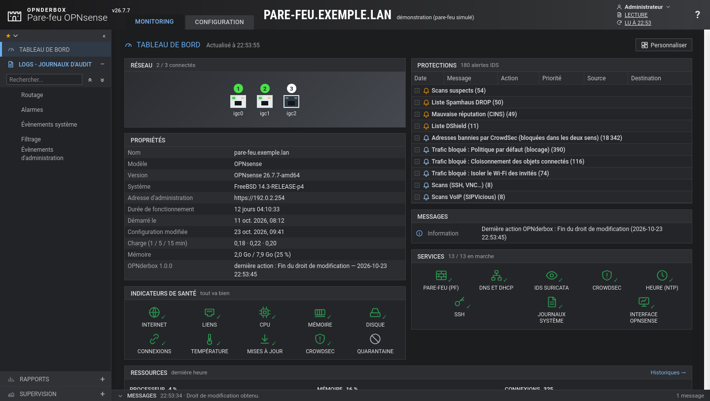

# OPNderbox

**Une console d'administration pour [OPNsense](https://opnsense.org) qui reprend l'ergonomie de Stormshield SNS** : bandeau MONITORING / CONFIGURATION, menu à gauche, grille de filtrage avec séparateurs et compteurs d'utilisation, édition des règles par onglets, objets réseau groupés par type, journaux avec panneau de détails… OPNderbox parle à OPNsense par son API ; il ne remplace pas son interface, il en offre une autre, en français, pensée pour l'exploitation au quotidien.



Chaque modification est préparée, vérifiée, puis envoyée en un lot avec **ANNULER / APPLIQUER**. Après application, vous avez 60 secondes pour confirmer ; sans confirmation, le pare-feu revient tout seul à l'état précédent. Une règle qui vous couperait l'accès ne reste donc jamais en place.

> OPNderbox n'est affilié ni à Stormshield ni à Deciso (OPNsense). Il s'inspire de l'organisation de l'interface SNS, sans en reprendre le logo ni les éléments graphiques.

## Ce que fait OPNderbox

| Monitoring | Configuration |
| --- | --- |
| Tableau de bord : réseau, propriétés, protections, messages, services, indicateurs de santé, ressources | Filtrage et NAT : politique en sections, séparateurs colorés, glisser-déposer, couper / copier / coller, 10 politiques enregistrées, export CSV |
| Journaux : filtrage en temps réel (avec « Autoriser ce trafic »), alarmes IDS, évènements système, routage, actions d'administration ; panneau de détails sur chaque ligne | Validateur de configuration : règles jamais atteintes, objets inutilisés, blocages non tracés |
| Historiques (processeur, mémoire, débits, connexions) sur 1 h à 1 an | Objets : machines, réseaux, noms DNS, ports, groupes, **objets temps** (plannings) |
| Supervision : système (mémoire, disques, températures), interfaces, machines, connexions (avec coupure), routage, services, baux DHCP, listes noires CrowdSec | Interfaces et VLAN en arbre, assistant « nouveau réseau » (VLAN, interface, DHCP et règles en une fois), routage, DHCP et DNS (dnsmasq) |
| **Quarantaine** : isoler une machine en un clic, pour une durée choisie | Règles implicites d'OPNsense, maintenance (mises à jour, sauvegardes et différences), préférences |

Un seul poste à la fois a le droit d'écriture : comme sur SNS, le bandeau est **bleu en ÉCRITURE et gris en LECTURE**.

| | |
| --- | --- |
|  |  |
|  |  |
|  |  |

## Correspondance avec Stormshield SNS

Les menus reprennent ceux de SNS pour ce qu'OPNsense sait faire. Ce qui n'a pas d'équivalent dans OPNsense (analyse sandboxing, antispam, filtrage URL et SSL par profils, réseau industriel, rapports par utilisateur…) n'est pas proposé.

| SNS | OPNderbox | |
| --- | --- | --- |
| Tableau de bord, Logs, Supervision | mêmes modules | journaux et supervision en lecture |
| Politique de sécurité > Filtrage et NAT, Règles implicites | mêmes modules | |
| Objets > Réseau | Objets > Réseau | les objets temps sont un type d'objet, comme sur SNS |
| Réseau > Interfaces, DHCP | mêmes modules | VLAN inclus |
| Réseau > Routage | Réseau > Routage | lecture seule : routes et passerelles se modifient dans OPNsense |
| Système > Maintenance, Préférences | mêmes modules | pas de restauration de configuration depuis OPNderbox |
| Système > Licence, Administrateurs | Système > Connexion à OPNsense | droits du compte API |
| Protection applicative, VPN, Utilisateurs, Notifications | — | à faire dans OPNsense |

## Essayer sans pare-feu

```sh
git clone https://github.com/Derbosoft/opnderbox.git
cd opnderbox
python3 demo/demo.py
```

Puis ouvrez <http://127.0.0.1:8080>. La démonstration simule l'OPNsense d'une petite entreprise fictive ; rien ne quitte votre poste.

## Installation

OPNderbox est un seul programme Python (bibliothèque standard uniquement, Python 3.9 ou plus). Il s'installe à côté d'OPNsense : une petite machine, une VM ou un conteneur LXC Debian / Ubuntu suffit (128 Mo de mémoire).

### Debian, Ubuntu, conteneur LXC Proxmox

```sh
git clone https://github.com/Derbosoft/opnderbox.git
cd opnderbox
sudo ./install.sh
```

L'installateur crée le compte de service `opnderbox`, le service systemd et la commande `opnderbox`, puis affiche l'adresse de l'**assistant de première configuration** (avec un jeton à usage unique). Options : `--port 8443`, `--desinstaller`, `--purger`. Pour mettre à jour : `git pull` puis `sudo ./install.sh` (la configuration est conservée).

### Docker

```sh
docker compose up -d
docker compose logs opnderbox     # ligne « Premiere configuration : https://…:8443/#setup=… »
```

Remplacez l'adresse affichée par celle de la machine qui fait tourner Docker. La configuration et l'historique sont gardés dans deux volumes.

## Relier OPNderbox à OPNsense

L'assistant s'ouvre au premier accès et vous guide en quatre étapes :

1. **Jeton** : celui affiché à l'installation (ou `sudo opnderbox setup`).
2. **Pare-feu** : l'adresse d'OPNsense. OPNderbox lit son certificat et vous montre l'empreinte ; une fois acceptée, il refusera tout autre certificat (protection contre l'usurpation).
3. **Compte API** : l'assistant vous donne une commande à coller dans la console d'OPNsense (option 8, « Shell »). Elle télécharge le script [`opnsense/opnderbox-compte-api.php`](opnsense/opnderbox-compte-api.php) depuis OPNderbox, vérifie son empreinte, crée le compte `opnderbox` avec les seuls droits nécessaires et affiche une clé. Collez la clé : OPNderbox vérifie chaque droit et vous dit ce qui manque. Vous préférez créer le compte à la main ? Voir [docs/compte-api.md](docs/compte-api.md).
4. **Mot de passe** de l'interface OPNderbox.

Tout est ensuite accessible sur `https://adresse-de-opnderbox/`. Le menu *Système > Connexion à OPNsense* revérifie les droits à tout moment.

**Règles gérées** : OPNderbox travaille sur les règles du nouvel écran d'OPNsense (*Pare-feu > Règles [new]*). Les règles créées dans l'ancien écran restent appliquées par OPNsense et apparaissent dans *Règles implicites* ; OPNsense propose un outil pour les migrer.

## Commandes utiles

```sh
sudo opnderbox setup       # adresse de l'assistant (tant qu'OPNderbox n'est relié à aucun pare-feu)
sudo opnderbox password    # changer le mot de passe de l'interface
sudo opnderbox status      # état du service
sudo opnderbox logs        # journal du service
```

Les réglages avancés (port, délai de confirmation, interfaces à masquer…) sont décrits dans [docs/configuration.md](docs/configuration.md).

## Sécurité

- Le compte API d'OPNsense n'a que les droits utiles (aucun accès au shell ni à la gestion des comptes).
- Le certificat d'OPNsense est épinglé par son empreinte SHA-256.
- Configuration et clé API sont lisibles par le seul compte `opnderbox` (fichiers en 0600) ; le service tourne sans privilèges, avec les protections de systemd.
- Interface en HTTPS, sessions limitées (30 min d'inactivité, 8 h au plus), blocage après 5 mots de passe faux, protection CSRF.
- OPNderbox refuse ce qui couperait son propre accès au pare-feu (interface ou VLAN par lequel il passe) et ne met jamais en quarantaine le poste d'administration, le pare-feu ou les passerelles.
- Chaque action est inscrite dans un journal (*Monitoring > Logs > Évènements d'administration*).

Exposez OPNderbox uniquement sur un réseau d'administration, comme l'interface d'OPNsense elle-même.

## Développement

```sh
python3 -m unittest discover -s tests     # tests du serveur et de la démonstration
python3 demo/demo.py                       # interface sur un pare-feu simulé
```

Le serveur tient dans [`opnderbox/server.py`](opnderbox/server.py) et l'interface dans [`opnderbox/static/index.html`](opnderbox/static/index.html), sans dépendance ni étape de compilation. Les polices Roboto sont fournies (licence Apache 2.0).

## Licence

[BSD 2-Clause](LICENSE), comme OPNsense.
